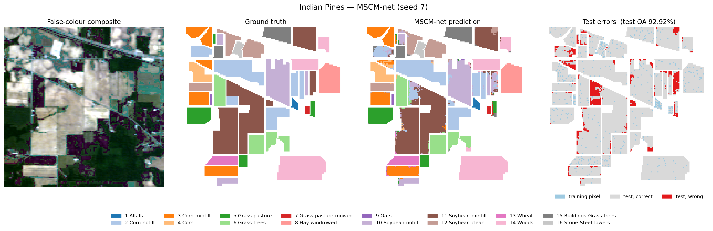
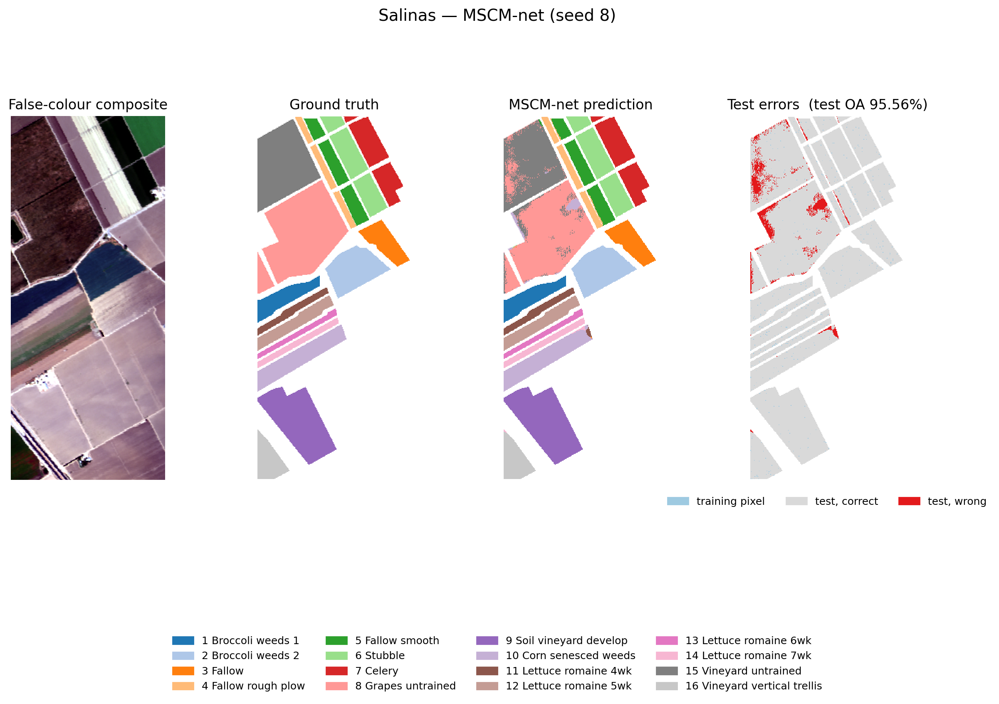
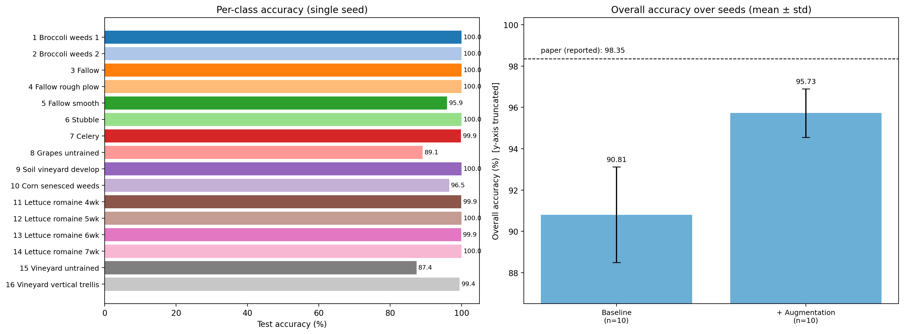

# MSCM-net reproduction: hyperspectral image classification with multi-scale CNN + Mamba

An independent, from-scratch PyTorch reproduction of **MSCM-net** (Chen et al., *"MSCM-net: A hyperspectral image classification method based on multi-scale convolution and Mamba"*, arXiv:2607.28277). The paper did not release code, so the architecture was rebuilt from its text, and every detail it leaves unspecified is listed below.

This is **not** the authors' code and **not** a new method. It is a reproduction plus a small set of controlled experiments.



## Results

Few-shot setting from the paper: **30 training pixels per class**, the rest for testing. All numbers are **mean ± std over 10 random splits (seeds 0 to 9)**, test accuracy of the final-epoch model, in %.

| Dataset | Setup | OA | AA | Kappa×100 |
|---|---|---|---|---|
| Indian Pines | Faithful to the paper (no augmentation) | 88.82 ± 2.86 | 94.43 ± 1.30 | 87.29 ± 3.22 |
| Indian Pines | + flip/rotation augmentation | **93.16 ± 1.13** | **96.67 ± 0.51** | **92.20 ± 1.28** |
| Indian Pines | *Paper (reported)* | *94.35* | *96.31* | *93.03* |
| Salinas | Faithful to the paper (no augmentation) | 90.81 ± 2.31 | 96.34 ± 1.10 | 89.77 ± 2.58 |
| Salinas | + flip/rotation augmentation | **95.73 ± 1.17** | **98.22 ± 0.51** | **95.24 ± 1.31** |
| Salinas | *Paper (reported)* | *98.35* | *98.99* | *98.16* |

**How to read this**

- The *faithful* rows follow the paper's description with no extras. They fall below the paper's numbers.
- Data augmentation (random flips and 90° rotations of each training patch) is **my addition**; the paper does not describe any. It improved overall accuracy on **10 of 10 seeds on both datasets** (paired comparison, same splits) and roughly halved the variance across splits. The augmented rows are therefore *not* a like-for-like comparison with the paper.
- On Indian Pines the augmented result is within about one standard deviation of the paper. On Salinas it is **not**: about 2.6 OA points short, which is outside seed noise.
- Where the Salinas errors are: in a typical run, roughly 80 to 90% of all errors come from two neighbouring vineyard classes (Grapes untrained and Vineyard untrained) being confused with each other. The other 14 classes are nearly solved.




### Other experiments (Indian Pines, 10 seeds each, overall accuracy)

| Change | OA | vs. faithful baseline (paired) |
|---|---|---|
| Dropout 0.1 → 0.3 | 90.97 ± 3.44 | +2.15, better on 9/10 seeds |
| Weight decay 1e-4 (Adam L2) | 87.07 ± 3.17 | −1.75, worse on 0/10 seeds |
| Augmentation | 93.16 ± 1.13 | +4.35, better on 10/10 seeds |
| Augmentation + dropout 0.3 | 93.52 ± 1.55 | +0.36 over augmentation alone, within noise |

Final configuration: augmentation only.

## What was built

```
input patch (30 PCA channels, 15×15)
 → 3×3 conv, no padding, 30→64 channels            (15×15 → 13×13)
 → MCSE: 1×1 | 3×3 depthwise-separable | 5×5 depthwise-separable, concatenated (192 ch)
         → squeeze-and-excitation → BN → ReLU → 1×1 conv to 128 ch
 → flatten to 169 tokens, add projected stem features (residual) + learnable position embedding
 → 4 Mamba blocks (selective state-space model)
 → centre token + mean of all tokens → MLP → class logits
```

The selective scan is written in plain PyTorch (no `mamba-ssm` CUDA kernel), so it runs on any GPU, including free Colab.

### Choices the paper does not specify (mine)

| Item | My choice | Why |
|---|---|---|
| PCA components | 30 | keeps 98.4% of variance on Indian Pines; common in this literature |
| How 15×15 becomes 13×13 | first 3×3 conv uses no padding | the only way to reach the paper's 13×13 = 169 tokens |
| MCSE output 192 ch → Mamba dim 128 | extra 1×1 conv | paper never says how |
| SE reduction ratio | 16 | not given |
| Dropout | 0.1 | not given |
| Position-embedding scale α | 1.0 | not given |
| Mamba settings | d_state 16, expand 2, conv width 4 | standard Mamba defaults |
| Discretisation of B | `dt·B` (as in the official Mamba code) | paper writes the exact ZOH form |
| Patches at image edges | zero padding | stated in the paper |
| Class split | 30 per class; classes with ≤30 pixels use half | reproduces the paper's Table 1 counts exactly |

## Limitations (please read)

- **Two of the paper's three datasets.** WHU-Hi-HongHu has not been run.
- **Hyperparameters were chosen by looking at test accuracy** (there is no separate validation set with 30 samples per class). Reported numbers are therefore slightly optimistic. The paper almost certainly has the same issue.
- **Model size:** 578,140 parameters, versus roughly 0.2 M reported in the paper. Its Mamba must be smaller than the standard configuration I used. I did not try to match it.
- **One-directional scan:** the sequence is read in a single row-by-row direction, as the paper describes.
- Training and test patches overlap spatially, as in the paper's protocol, so test pixels' spectra appear inside some training patches.
- Seed 0 of the Indian Pines faithful baseline was produced by an earlier, mathematically equivalent but slower version of the scan.

## Speed

The first implementation took about 49 minutes per 100-epoch run. Autograd was allocating a full-size zero gradient tensor at every step of the 169-step scan because of `a[:, t]` indexing. Iterating with `unbind` instead brought it to about 2.5 minutes per run on a free Colab T4 (19× faster) with identical outputs.

## Run it

```bash
pip install -r requirements.txt
```

1. **Get the data** (not included in this repo). Indian Pines and Salinas (`*_corrected.mat` and `*_gt.mat`) are available from the Grupo de Inteligencia Computacional page: https://www.ehu.eus/ccwintco/index.php/Hyperspectral_Remote_Sensing_Scenes
2. Put the `.mat` files in `data/Indian_Pines/` and `data/Salinas/`.
3. Train and evaluate one seed:

```python
import train
res = train.run("data/Indian_Pines/indian_pines_data.mat",
                "data/Indian_Pines/indian_pines_gt.mat",
                name="indian_pines", seed=0, epochs=100, augment=True)
```

4. 10-seed experiments with saved results and paired comparisons: `experiments.py` (see `notebooks/`). Figures: `figures.py`.

The notebooks assume Google Colab with data on Google Drive. Change the paths at the top of each notebook to run elsewhere.

## Files

| File | Purpose |
|---|---|
| `hsi_data.py` | loading, standardisation, PCA, padding, per-class split, patch dataset |
| `mscm_modules.py` | stem and MCSE module |
| `mscm_net.py` | selective SSM, Mamba block, full model |
| `train.py` | training loop, OA / AA / Kappa, augmentation |
| `experiments.py` | multi-seed runs and paired comparisons |
| `figures.py` | classification maps and result plots |
| `notebooks/` | Colab notebooks used for the runs |

## Credit

Architecture and datasets from the paper above and the original dataset providers. Please cite the paper if you use this. Code in this repository: MIT License.
